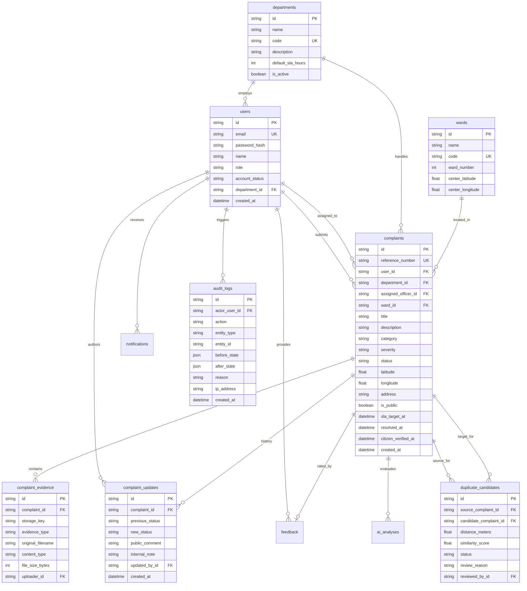

# CivicLens AI — Relational Database Schema

CivicLens AI uses SQLAlchemy 2.0 with Alembic database migrations. The application supports PostgreSQL (e.g., Supabase / Neon / AWS RDS) for production deployments and SQLite for local development and integration testing.

---

## 1. Entity-Relationship Diagram

---

## 2. Table Specifications

### 2.1 `users`
Represents registered citizens, municipal department officers, and system administrators.
- `id` (`VARCHAR(36)`, PK): UUIDv4 identifier.
- `email` (`VARCHAR(255)`, UNIQUE, NOT NULL, INDEXED): Unique citizen or corporate municipal email.
- `password_hash` (`VARCHAR(255)`, NOT NULL): Passlib / bcrypt hashed password (never plaintext).
- `name` (`VARCHAR(150)`, NOT NULL): User's legal full name.
- `role` (`VARCHAR(20)`, NOT NULL, DEFAULT `'CITIZEN'`): Enum (`'CITIZEN'`, `'OFFICER'`, `'ADMIN'`).
- `phone` (`VARCHAR(30)`, NULLABLE): Contact phone or helpline.
- `default_location` (`VARCHAR(255)`, NULLABLE): Citizen home zone or neighborhood.
- `department_id` (`VARCHAR(36)`, FK → `departments.id`, NULLABLE): Department jurisdiction (for officers).
- `account_status` (`VARCHAR(20)`, NOT NULL, DEFAULT `'ACTIVE'`): `'ACTIVE'`, `'INACTIVE'`, `'SUSPENDED'`.
- `created_at` / `updated_at` (`TIMESTAMP WITH TIME ZONE`, NOT NULL).

### 2.2 `departments`
Municipal divisions handling specific public works and municipal services.
- `id` (`VARCHAR(36)`, PK): UUIDv4.
- `name` (`VARCHAR(150)`, NOT NULL): e.g. "Public Works Department", "Solid Waste Management".
- `code` (`VARCHAR(20)`, UNIQUE, NOT NULL): e.g. "PWD", "SWM", "ELEC", "DRAIN", "TRAFF".
- `description` (`TEXT`, NULLABLE): Scope of municipal operations.
- `contact_email` (`VARCHAR(255)`, NULLABLE): Official helpdesk mailbox.
- `contact_phone` (`VARCHAR(50)`, NULLABLE): Emergency dispatch phone number.
- `default_sla_hours` (`INTEGER`, NOT NULL, DEFAULT `48`): Default resolution turnaround SLA in hours.
- `coverage_areas` (`JSON`, NULLABLE): Array of covered ward IDs or zone names.
- `is_active` (`BOOLEAN`, NOT NULL, DEFAULT `TRUE`): Operational toggle.

### 2.3 `wards`
Municipal administrative territorial subdivisions (seeded with Pune Metro zones).
- `id` (`VARCHAR(36)`, PK): UUIDv4.
- `name` (`VARCHAR(100)`, NOT NULL): e.g. "Shivajinagar", "Kothrud", "Aundh-Baner", "Hadapsar".
- `code` (`VARCHAR(20)`, UNIQUE, NOT NULL): e.g. "WARD-01", "WARD-02".
- `ward_number` (`INTEGER`, NOT NULL): Integer council zone identifier.
- `city` (`VARCHAR(100)`, NOT NULL, DEFAULT `'Pune'`): Municipal corporation jurisdiction.
- `center_latitude` / `center_longitude` (`FLOAT`, NOT NULL): Spatial centroid coordinates.
- `radius_meters` (`INTEGER`, NOT NULL, DEFAULT `3000`): Radial bounding boundary.
- `office_address` (`VARCHAR(255)`, NULLABLE): Local ward office location.

### 2.4 `complaints`
Primary civic issue entity containing geo-location, evidence, categorization, and lifecycle state.
- `id` (`VARCHAR(36)`, PK): UUIDv4.
- `reference_number` (`VARCHAR(30)`, UNIQUE, NOT NULL, INDEXED): e.g. `CLN-2026-1001`.
- `user_id` (`VARCHAR(36)`, FK → `users.id`, NOT NULL): Reporting citizen.
- `title` (`VARCHAR(255)`, NOT NULL): Clear summary of the defect.
- `description` (`TEXT`, NOT NULL): Detailed citizen report.
- `category` (`VARCHAR(50)`, NOT NULL, INDEXED): `POTHOLE`, `GARBAGE`, `STREETLIGHT`, `DRAINAGE`, `ROAD_DAMAGE`, `DAMAGED_SIGN`, `WATER_LEAKAGE`, `ILLEGAL_DUMPING`, `OTHER`.
- `severity` (`VARCHAR(20)`, NOT NULL, INDEXED): `LOW`, `MEDIUM`, `HIGH`, `CRITICAL`.
- `severity_explanation` (`TEXT`, NULLABLE): Rationale for severity classification.
- `ai_confidence` (`FLOAT`, NOT NULL, DEFAULT `0.0`): Prediction probability (0.00 to 1.00).
- `ai_analysis_mode` (`VARCHAR(30)`, NOT NULL, DEFAULT `'RULE_BASED'`): `'AI_GEMINI'`, `'RULE_BASED'`, `'MANUAL'`.
- `department_id` (`VARCHAR(36)`, FK → `departments.id`, NULLABLE, INDEXED): Assigned department.
- `assigned_officer_id` (`VARCHAR(36)`, FK → `users.id`, NULLABLE): Designated field officer.
- `ward_id` (`VARCHAR(36)`, FK → `wards.id`, NULLABLE, INDEXED): Geographic ward.
- `status` (`VARCHAR(30)`, NOT NULL, DEFAULT `'SUBMITTED'`, INDEXED): Current lifecycle state.
- `latitude` / `longitude` (`FLOAT`, NOT NULL, INDEXED): Decimal coordinates (WGS 84).
- `address` (`TEXT`, NOT NULL): Street address or location landmarks.
- `is_public` (`BOOLEAN`, NOT NULL, DEFAULT `TRUE`): Public transparency map visibility.
- `sla_target_at` (`TIMESTAMP WITH TIME ZONE`, NULLABLE): Calculated deadline for resolution.
- `resolution_notes` (`TEXT`, NULLABLE): Field summary of remediation work.
- `resolved_at` / `citizen_verified_at` (`TIMESTAMP WITH TIME ZONE`, NULLABLE).

### 2.5 `complaint_evidence`
Photographs, audio clips, and remediation verification documents.
- `id` (`VARCHAR(36)`, PK): UUIDv4.
- `complaint_id` (`VARCHAR(36)`, FK → `complaints.id`, NOT NULL, ON DELETE CASCADE).
- `storage_key` (`VARCHAR(255)`, NOT NULL): File path or object key in local storage / Supabase.
- `evidence_type` (`VARCHAR(30)`, NOT NULL, DEFAULT `'BEFORE_IMAGE'`): `'BEFORE_IMAGE'`, `'AFTER_IMAGE'`, `'AUDIO'`.
- `original_filename` (`VARCHAR(255)`, NULLABLE): Uploaded file name.
- `content_type` (`VARCHAR(100)`, NOT NULL): MIME type (e.g. `image/jpeg`, `image/png`, `audio/webm`).
- `file_size_bytes` (`INTEGER`, NOT NULL): Size in bytes (max 10MB enforced).
- `uploader_id` (`VARCHAR(36)`, FK → `users.id`, NULLABLE).

### 2.6 `complaint_updates`
Immutable timeline audit events for complaint status transitions.
- `id` (`VARCHAR(36)`, PK): UUIDv4.
- `complaint_id` (`VARCHAR(36)`, FK → `complaints.id`, NOT NULL, ON DELETE CASCADE).
- `previous_status` / `new_status` (`VARCHAR(30)`, NOT NULL).
- `public_comment` (`TEXT`, NULLABLE): Visible to reporting citizen.
- `internal_note` (`TEXT`, NULLABLE): Visible only to municipal staff.
- `updated_by_id` (`VARCHAR(36)`, FK → `users.id`, NOT NULL).

### 2.7 `duplicate_candidates`
Pairs of complaints identified by spatial proximity and textual similarity.
- `id` (`VARCHAR(36)`, PK): UUIDv4.
- `source_complaint_id` / `candidate_complaint_id` (`VARCHAR(36)`, FK → `complaints.id`, NOT NULL).
- `distance_meters` (`FLOAT`, NOT NULL): Calculated radial distance between coordinates.
- `similarity_score` (`FLOAT`, NOT NULL): Combined similarity score (0.0 to 1.0).
- `status` (`VARCHAR(30)`, NOT NULL, DEFAULT `'DETECTED'`): `'DETECTED'`, `'CONFIRMED_DUPLICATE'`, `'DISMISSED'`.
- `review_reason` (`TEXT`, NULLABLE): Mandatory reason provided during officer review.
- `reviewed_by_id` (`VARCHAR(36)`, FK → `users.id`, NULLABLE).

### 2.8 `audit_logs`
Append-only governance log recording sensitive system changes, role promotions, and overrides.
- `id` (`VARCHAR(36)`, PK): UUIDv4.
- `actor_user_id` (`VARCHAR(36)`, FK → `users.id`, NULLABLE).
- `action` (`VARCHAR(100)`, NOT NULL, INDEXED): e.g. `UPDATE_USER_ROLE`, `STATUS_TRANSITION`, `AI_OVERRIDE`.
- `entity_type` (`VARCHAR(50)`, NOT NULL, INDEXED): `USER`, `COMPLAINT`, `DEPARTMENT`, `SETTING`.
- `entity_id` (`VARCHAR(100)`, NULLABLE).
- `before_state` / `after_state` (`JSON`, NULLABLE): Serialized dictionary diffs.
- `reason` (`TEXT`, NULLABLE): Mandatory explanation note.
- `ip_address` (`VARCHAR(50)`, NULLABLE): Client IP address.
- `created_at` (`TIMESTAMP WITH TIME ZONE`, NOT NULL, INDEXED).

### 2.9 `system_settings`
Key-value runtime configuration parameters.
- `key` (`VARCHAR(100)`, PK): e.g. `duplicate_distance_threshold_meters`, `default_sla_hours`.
- `value` (`JSON`, NOT NULL): Configurable integer, float, boolean, or array value.
- `description` (`TEXT`, NULLABLE).
- `updated_by_id` (`VARCHAR(36)`, FK → `users.id`, NULLABLE).
- `updated_at` (`TIMESTAMP WITH TIME ZONE`, NOT NULL).
